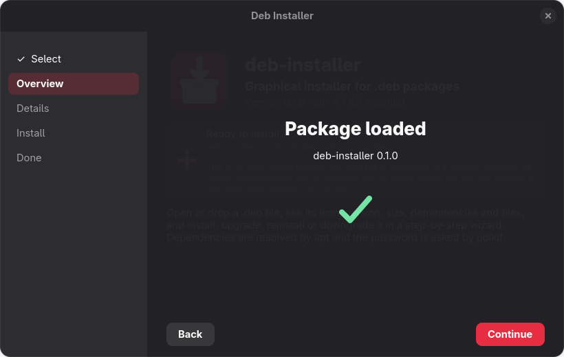
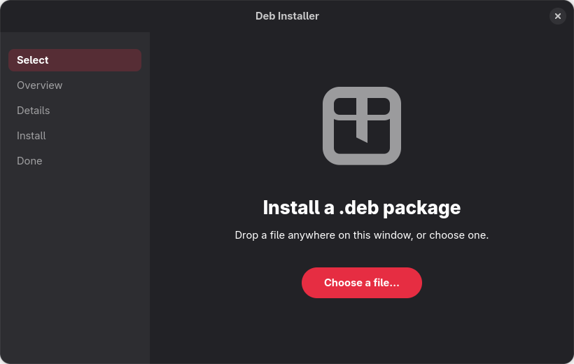
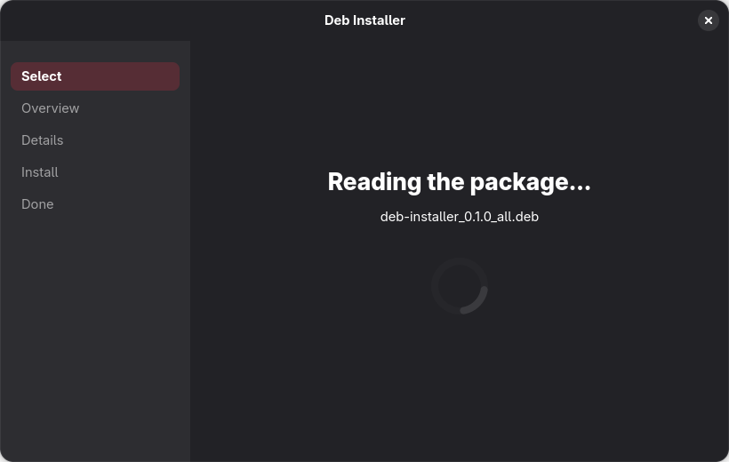
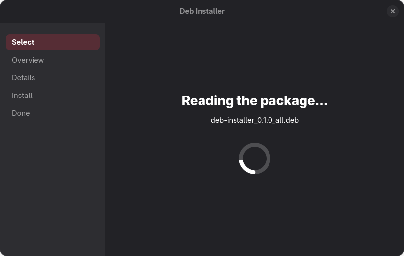
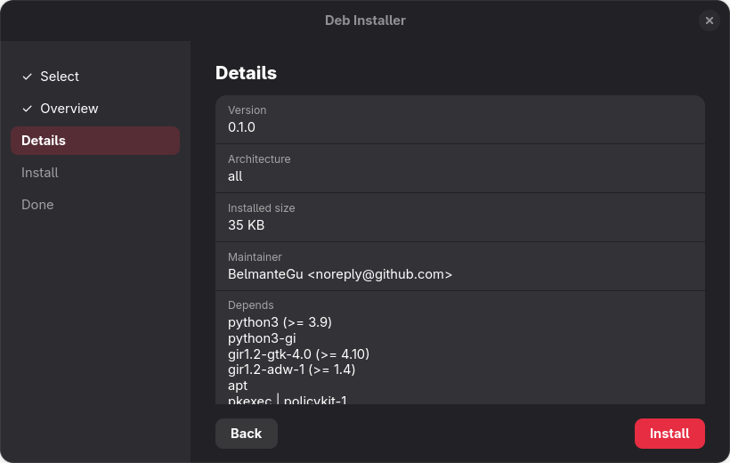

<div align="center">


# Deb Installer

**Instale qualquer `.deb` com um assistente, em qualquer distro.**

Abra ou arraste o arquivo, veja o ícone, as dependências e os arquivos, e instale. No Debian, Ubuntu e Mint ele usa o apt. No Arch, CachyOS e Manjaro ele converte o pacote para o pacman.


<br />

<a href="https://github.com/BelmanteGu/deb-installer/releases/latest">
  
</a>
&nbsp;
<a href="docs/COMO-FUNCIONA.md">
  
</a>
&nbsp;
<a href="docs/DESENVOLVIMENTO.md">
  
</a>


</div>

---

## 📖 Sobre

Instalar um `.deb` fora do Debian costuma ser chato: linha de comando, dependências soltas, nenhuma ideia do que o pacote
vai colocar no seu sistema. O **Deb Installer** resolve isso com um assistente horizontal, como os instaladores do Mac:
você vê o que está instalando antes de instalar, e acompanha o progresso depois.

<div align="center">



</div>

## ✨ O que o app tem

- 🧭 **Assistente em 5 etapas:** Select, Overview, Details, Install e Done, com a barra de etapas à esquerda.
- 🖱️ **Arraste e solte:** solte o `.deb` na janela ou escolha pelo botão.
- ⏳ **Carregamento com animação:** um spinner enquanto o pacote é lido e um ✓ quando deu certo.
- 🗂️ **Ícone nos arquivos:** todo `.deb` no gerenciador de arquivos ganha o ícone do app com um selo `.deb` no canto. Ao abrir um `.deb` no app, o selo vira o **ícone do próprio pacote** (por exemplo o do Claude).
- 🖼️ **Ícone do app:** o ícone que o pacote traz aparece na tela, em SVG ou PNG.
- 🔍 **Detalhes completos:** versão, arquitetura, tamanho instalado, mantenedor, dependências e a lista de arquivos.
- 🔄 **Sabe o que fazer:** instalar, atualizar, reinstalar ou fazer downgrade, comparando com a versão já instalada.
- 📜 **Log ao vivo:** a saída do apt ou do pacman aparece na janela, e dá para tentar de novo se falhar.
- 🔐 **Senha pelo polkit:** o app roda como o seu usuário e nunca vê a sua senha.
- 🐧 **Debian e Arch:** `apt-get` no Debian, Ubuntu e Mint; conversão para pacman no Arch, CachyOS e Manjaro.
- 🪶 **Leve:** o `.deb` do app tem menos de 20 KB, em Python puro sobre GTK4/libadwaita.

## 📸 Prints

| | |
|---|---|
|  **1. Select:** escolha ou arraste o `.deb`. |  **Lendo:** o spinner roda enquanto o pacote é lido. |
|  **Carregado:** o ✓ mostra que deu certo. |  **2. Overview:** ícone, versão e o que vai acontecer. |
|  **3. Details:** dependências, tamanho e arquivos. | |

## 📲 Como instalar

### Debian, Ubuntu, Linux Mint

1. Baixe o `deb-installer_X.Y.Z_all.deb` na [versão mais nova](https://github.com/BelmanteGu/deb-installer/releases/latest).
2. Instale:

```
sudo apt install ./deb-installer_0.1.0_all.deb
```

3. Abra **Deb Installer** no menu. Depois disso, dê dois cliques em qualquer `.deb` para abrir nele.

### Arch, CachyOS, Manjaro e outras

Não há pacote para o pacman. Instale a partir do código, só para o seu usuário (sem `sudo`):

```
sudo pacman -S python-gobject python-cairo gtk4 libadwaita zstd polkit
git clone https://github.com/BelmanteGu/deb-installer
cd deb-installer
./install.sh
```

Para remover: `./install.sh --uninstall`.

> [!NOTE]
> No Arch o app converte o `.deb` num pacote do pacman. As dependências do Debian **não são verificadas** e os scripts de
> instalação do `.deb` **não rodam**. Se o programa não abrir, falta alguma biblioteca: instale com `pacman -S`.
> Para remover um programa instalado assim: `sudo pacman -R <nome>`.

## ✅ Requisitos

- Python 3.9 ou mais novo, GTK 4.10+ e libadwaita 1.4+ (Ubuntu 24.04, Debian 13, Linux Mint 22 ou mais novos; Arch atual).
- `pkexec` (polkit) para pedir a senha.
- No Debian: `apt`. No Arch: `pacman` (e `zstd`, que acelera a conversão).

## 🧪 O que foi testado

| Item | Estado |
|---|---|
| Ler `.deb` (control, arquivos, ícone, `.gz`/`.xz`/`.zst`) | ✅ testado, com testes automáticos e com um `.deb` real de 625 MB |
| Interface completa (5 etapas, carregamento, ícone) | ✅ testada no CachyOS (os prints são desse teste) |
| Conversão para pacman e instalação no CachyOS | ✅ testada: o pacote convertido foi aceito pelo pacman e instalado |
| Instalar o `.deb` do app com `apt` | ✅ o CI do GitHub instala o pacote num Ubuntu a cada commit ([Actions](https://github.com/BelmanteGu/deb-installer/actions)) |
| Botão Install (`apt-get` via `pkexec`) no Debian/Ubuntu | ⏳ ainda não verificado numa máquina real com interface gráfica |

Achou um problema? [Abra uma issue](https://github.com/BelmanteGu/deb-installer/issues) dizendo a distro e a versão.

## 🛠️ Para quem quer mexer

- [Como funciona](docs/COMO-FUNCIONA.md): arquivos, etapas, a conversão para pacman e a segurança.
- [Desenvolvimento](docs/DESENVOLVIMENTO.md): rodar, testar, gerar o `.deb` e publicar uma versão.
- [Contribuindo](CONTRIBUTING.md).

## 📄 Licença

[MIT](LICENSE). Use, mude e distribua à vontade.

<div align="center">

Feito por [BelmanteGu](https://github.com/BelmanteGu).

</div>
